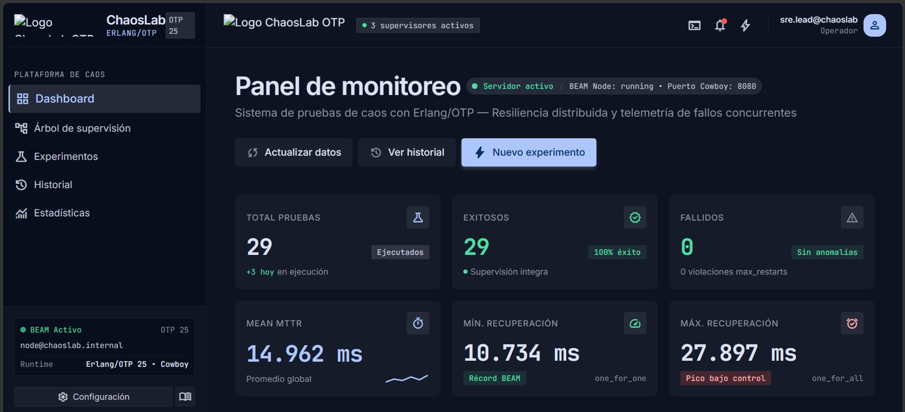
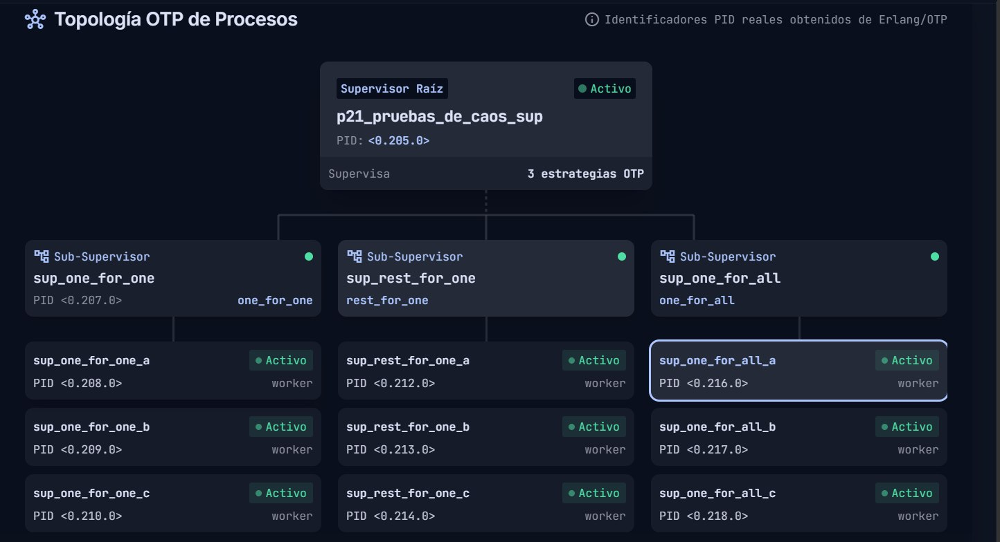
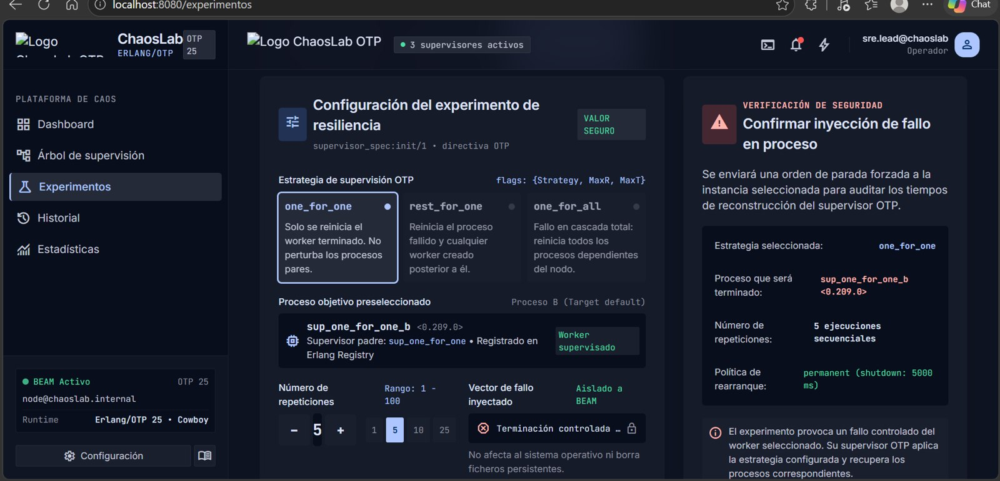
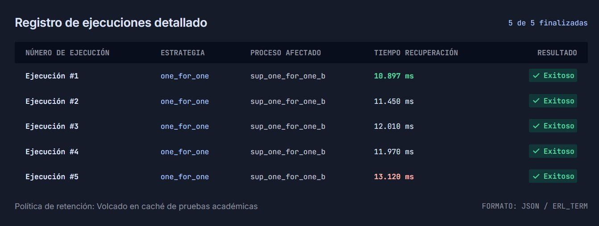
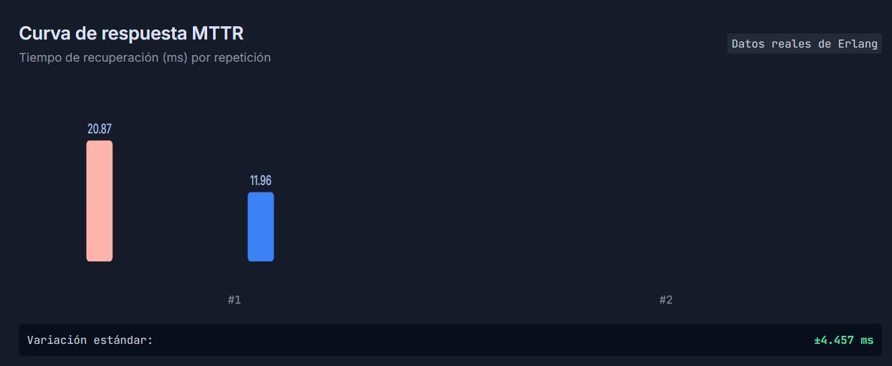

# ChaosLab OTP — Manual de usuario 📘

**Proyecto original #21: Pruebas de caos en Erlang/OTP** · No es el proyecto de gemelo digital en SWI-Prolog.

Manual práctico para instalar, acceder y utilizar la plataforma de experimentos de recuperación de procesos. El sistema usa supervisores OTP (`one_for_one`, `rest_for_one`, `one_for_all`), un backend con Cowboy y una interfaz web de cinco secciones.

> **Sobre el material:** Las cinco imágenes son **capturas reales tomadas durante el desarrollo**, en fechas y etapas diferentes; algunas pueden mostrar etiquetas o datos anteriores a la revisión final. Los archivos de `ejemplos/frontend/` son **implementaciones didácticas independientes**, no copias verificadas de los archivos originales. Para publicar el código exacto se debe copiar desde el servidor donde funciona el proyecto.

## Accesos rápidos

| Recurso | Contenido |
| --- | --- |
| [Manual completo](docs/MANUAL_COMPLETO.md) | Instalación, AWS, funcionamiento, API y solución de problemas |
| [Guía por pantallas](docs/PANTALLAS.md) | Capturas, botones y recorrido de uso |
| [Arquitectura](docs/ARQUITECTURA.md) | Supervisión, módulos, rutas y flujo de datos |
| [Código didáctico de pantallas](ejemplos/frontend/) | HTML, CSS y JavaScript para consultar una API compatible |
| [Ejemplos de llamadas REST](ejemplos/api/consultas.http) | Consultas GET y POST |
| [Publicación en GitHub](docs/PUBLICAR_EN_GITHUB.md) | Pasos para crear un repositorio propio |
| [Incorporar código real](docs/INCORPORAR_CODIGO_REAL.md) | Copiar los archivos finales del EC2 al manual |

## Las cinco pantallas

### 1. Dashboard



Muestra experimentos realizados, recuperaciones exitosas y fallidas, MTTR y actividad reciente. Los números dependen del historial del backend; los valores de la captura no son datos en tiempo real.

### 2. Árbol de supervisión



Muestra el supervisor raíz, tres estrategias, nueve workers, sus PID y el control para provocar un fallo seleccionado.

### 3. Experimentos



Permite elegir estrategia, configurar el número de repeticiones, confirmar una inyección de fallo y consultar los resultados. Esta captura conserva algunos elementos de interfaz de una etapa previa.

### 4. Historial



Lista experimentos persistidos y permite consultar filtros y resultados anteriores.

### 5. Estadísticas



Compara tiempos, totales y recuperaciones según la estrategia OTP.

## Inicio rápido (versión funcional ya disponible)

**En Ubuntu con el código de la versión desarrollada, no con el esqueleto del repositorio del profesor:**

```bash
cd ~/erlang-proyectos/proyectos/21-pruebas-de-caos
rebar3 compile
rebar3 eunit
rebar3 shell
```

Dentro del intérprete Erlang:

```erlang
caos_http:iniciar().
```

Si se ejecuta en AWS, establecer desde Windows el túnel (usar la IP pública *actual*, no una antigua):

```powershell
ssh -i ".\labsuser.pem" -L 8080:127.0.0.1:8080 ubuntu@IP_PUBLICA_ACTUAL
```

Abrir `http://localhost:8080/dashboard`. No es necesario exponer el puerto 8080 públicamente.

**Importante:** `https://github.com/tectijuana/erlang-proyectos/tree/main/proyectos/21-pruebas-de-caos` es la base del ejercicio. Puede no incluir la implementación final de ChaosLab desarrollada localmente.

## Ejemplo de ejecución desde la API

```bash
curl -X POST http://127.0.0.1:8080/api/experimentos \
  -H 'Content-Type: application/json' \
  -d '{"estrategia":"one_for_one","cantidad":1}'
```

En esta operación se provoca un fallo controlado (worker B por defecto); `exitosos` significa que se comprobó la **recuperación correcta**, no que no hubo caída.

## Contexto académico

- [Proyecto original del profesor (Erlang)](https://github.com/tectijuana/erlang-proyectos/tree/main/proyectos/21-pruebas-de-caos)
- Este manual **no** documenta la extensión `logicfun-proyectos/gemelo/` de Prolog.
- Herramientas utilizadas: Erlang/OTP 25, Rebar3 3.19, Cowboy 2.12 y frontend HTML/JavaScript.

## Autoría y procedencia

Manual preparado con base en las funciones, pruebas y capturas de desarrollo compartidas durante el proyecto. Código en `ejemplos/` diseñado para aprendizaje y demostración; no se debe atribuir como reproducción literal del código productivo.
