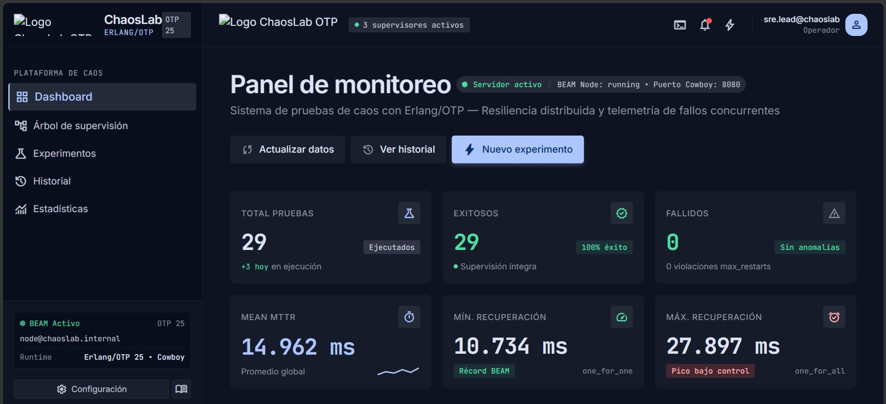
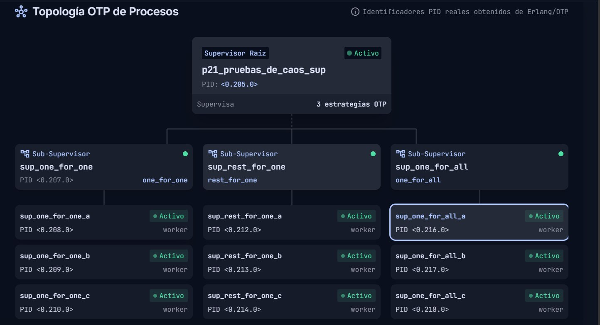
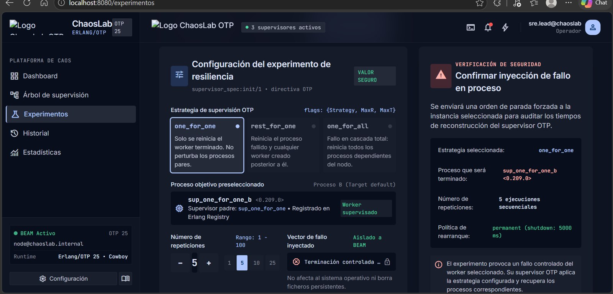
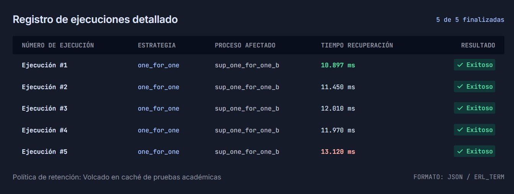
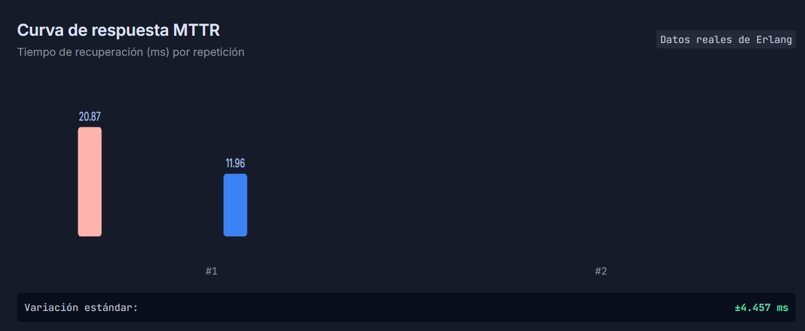

# Manual visual — cinco pantallas

**Alcance:** ChaosLab OTP original. Las imágenes proceden de sesiones reales de desarrollo y pueden corresponder a etapas distintas; no son lecturas en vivo.

## Dashboard (`/dashboard`)

**Para qué sirve:** ofrece una vista global de la salud del experimento. Los indicadores representan pruebas realizadas, recuperaciones comprobadas, recuperaciones fallidas, media, mínimo y máximo de tiempo. Contiene un resumen de estrategias, árbol compacto, actividad reciente y botón de nuevo experimento.

**Uso:** entrar al panel; comprobar el estado del backend; observar indicadores; pulsar "Nuevo experimento" para crear una prueba con confirmación; actualizar para consultar valores recientes.

**Lectura correcta:** `30 realizados`, `30 exitosos`, `0 fallidos` implica treinta experimentos que inyectaron una caída y verificaron recuperación; **no** significa que no se hayan provocado fallos.

## Árbol de supervisión (`/arbol`)

**Para qué sirve:** inspeccionar el supervisor raíz, los tres supervisores de estrategia y los procesos A/B/C con PID. El usuario puede seleccionar un proceso y ejecutar una caída controlada.

**Uso:** seleccionar un worker; comprobar su PID; confirmar "Simular fallo"; esperar la actualización del árbol y comparar el PID anterior con el nuevo. El historial registra el worker seleccionado.

**Advertencia:** `one_for_one` reinicia solo el proceso caído; `rest_for_one` reinicia el caído y posteriores; `one_for_all` reinicia los tres workers hermanos del mismo supervisor.

## Experimentos (`/experimentos`)

**Para qué sirve:** elegir estrategia, revisar worker objetivo (B por defecto), seleccionar repeticiones de 1 a 100, confirmar y ejecutar. La interfaz muestra resultados medidos, no tiempos estáticos.

**Uso:** elegir estrategia → seleccionar cantidad → revisar y confirmar → ejecutar → observar tabla y gráfica de resultados. No realizar un gran número de fallos rápidos porque OTP tiene límites de intensidad por periodo.

**Nota de captura:** puede mostrar una etapa previa de textos de interfaz, aunque en el desarrollo se corrigieron etiquetas de políticas.

## Historial (`/historial`)

**Para qué sirve:** consultar resultados persistidos, incluyendo fecha UTC, supervisor, worker afectado, tiempo y éxito de recuperación. Dispone de filtros y navegación en registros.

**Uso:** consultar un registro después de ejecutar una prueba; filtrar por estrategia; verificar proceso afectado y tiempo; usar los controles disponibles de exportación si aparecen en su versión.

## Estadísticas (`/estadisticas`)

**Para qué sirve:** consultar métricas agregadas globales y agrupadas por estrategia.

**Uso:** comparar el número de experimentos y el promedio medido de cada estrategia; evitar concluir que una estrategia es universalmente "mejor" solo por un promedio de una muestra pequeña.

## Ejemplos de código de las pantallas

En [`ejemplos/frontend/`](../ejemplos/frontend/) hay cinco páginas HTML y un archivo compartido `app.js`. Son **ejemplos didácticos** que consumen rutas compatibles con la API del proyecto. La interfaz final original se encuentra en la carpeta `frontend/` de la instancia donde se desarrolló ChaosLab; cómo incorporarla está explicado en [Incorporar código real](INCORPORAR_CODIGO_REAL.md).
